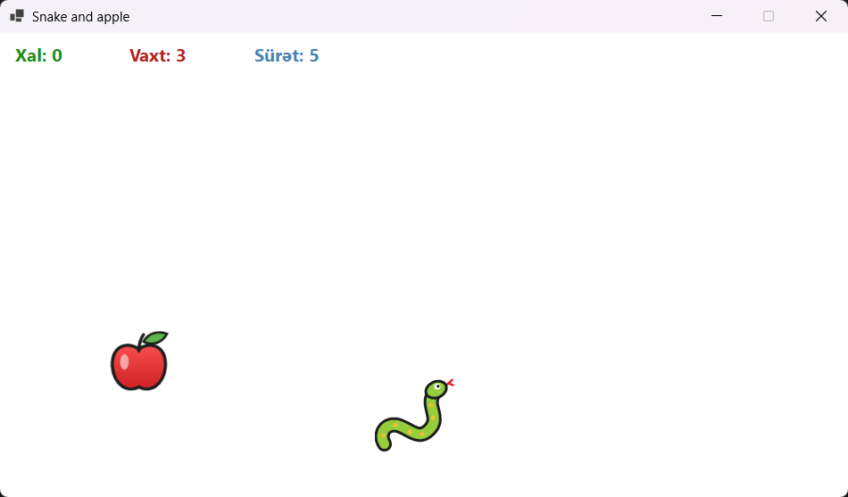

# Snake and apple

Bu layihə C# Windows Forms ilə yazılmış ilan və alma oyunudur.

## Oyunun qaydaları

- İlanı klaviaturadakı **ox düymələri** (← → ↑ ↓) ilə idarə edirsən.
- İlan **almanı yedikcə xal toplayır**, alma isə random başqa yerə atılır.
- Hər alma yeyiləndə **ilanın sürəti artır**.
- Alma ilə paralel **bomba** da var: alma yeyildikdən sonra və ya yeyilmədən vaxt bitəndə, random olaraq (3-dən 1 ehtimalla) bombaya çevrilə bilər.
- İlan almanı **5 saniyə ərzində** yeməlidir. Alma və ya bomba ekranda 5 saniyə qalır, sonra random başqa yerə atılır.
- **Bomba yeyilsə oyun bitir** və nəticə `MessageBox` ilə ekrana verilir.
- **Enter** ilə yeni oyun başlayır: xal və ilanın sürəti sıfırlanır.
- İlan ekranın kənarından çıxanda o biri tərəfdən girir.

## Kodun quruluşu

| Element | Vəzifəsi |
|---|---|
| `snake`, `apple`, `bomb` | `PictureBox` – ilan, alma və bomba şəkilləri |
| `timer1` (20 ms) | ilanın hərəkəti, alma/bomba ilə toqquşma |
| `timer2` (1 saniyə) | 5 saniyəni geri sayır, vaxt bitəndə yeni alma/bomba atır |
| `NewItem()` | alma və ya bombanı random seçib random yerə atır |
| `RestartGame()` | xalı, sürəti və ilanın yerini sıfırlayır |
| `Form1_KeyDown` | ox düymələri ilə istiqamət, Enter ilə yeni oyun |

Şəkillər `SnakeAndApple/Images` qovluğundadır və proqram işə düşəndə oradan yüklənir.

## Necə işə salmaq olar

1. **Visual Studio 2022 Community** proqramını ".NET desktop development" komponenti ilə qur.
2. `SnakeAndApple.sln` faylını aç.
3. **F5** düyməsini bas və ya yuxarıdakı **▶ Start** düyməsinə kliklə.

## Texnologiyalar

- C#
- .NET 8
- Windows Forms
